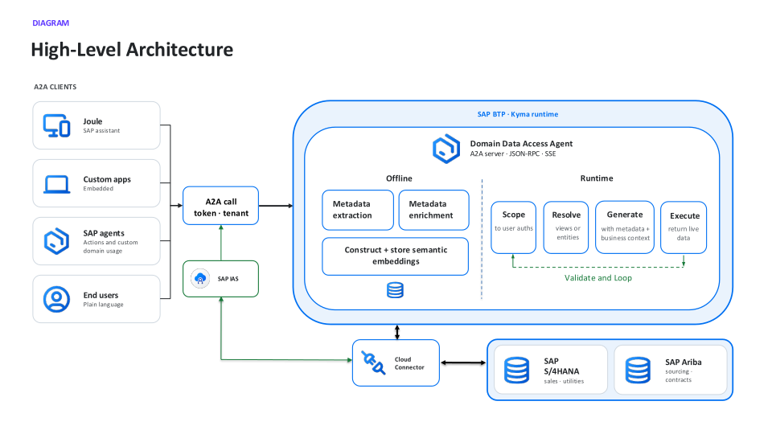

# Exercise 0 - Start here

> **What you will do:** get connected, tell us who you are, and read the three short pieces that explain what you are using. The app is a set of tabs; you work through them left to right, and each guided tab tracks a few steps. Finish every tab to earn the passcode that unlocks Freestyle.

> [!IMPORTANT]
> This is an early preview. The SAP Domain Data Access Agent is still in development and will be released to Early Adopter Care customers, so capabilities and responses may change. The app is a workshop demonstration and its sign-in screens are simulated, but the questions you run do call live running services against real SAP data. Do not treat any result as production output.

The tabs:

- **Start here** - setup and reading (this exercise).
- **Simulator** - how the agent works under the hood.
- **Joule** - the agent inside the SAP assistant. You sign in through SAP Identity Authentication as a business role, then ask in plain language, across more than one SAP system.
- **Applications** - the same agent inside a custom app, shaped for a role.
- **Agents** - the same agent as a tool your own agent calls over A2A.
- **Freestyle** - unlocked at the end: ask anything, as any role.

## Step 1 - Open the service

1. In Chrome or Edge, open the URL the presenter gives you:
   > `[Presenter fills in live: attendee-facing service URL]`
2. Enter the credentials the presenter shares.
3. You land on the **Start here** tab.

> [!TIP]
> If the URL does not load, check your internet connection (TechEd guest Wi-Fi is fine). If it still fails, flag a presenter.

## Step 2 - Tell us who you are

Click **Tell us who you are** and fill in what you like (role, SAP domains, familiarity). It is anonymous and every field is skippable. Submit or skip. This is the first checked step.

## Step 3 - Read: what is the Domain Data Access Agent

A governed, natural-language-to-data access layer for SAP systems like SAP S/4HANA and SAP Ariba. You ask a business question in plain language; it finds the data that answers it, runs a query live against the system, and returns an answer scoped to the user's own authorizations. No schema knowledge required.

At a high level, any client (Joule, a custom app, your own agent, or an end user) reaches the agent over A2A, authenticated through SAP Cloud Identity Services. The agent runs on SAP BTP: an offline pipeline turns SAP metadata into a searchable semantic layer, and a runtime loop scopes, retrieves, generates, and validates a query per request, executed as the signed-in user against the live system.

Open the overview link on the tab, then expand **See the live agent card** to see what the app discovers about the agent over A2A (its name, skill, and transport).

## Step 4 - Read: SAP Domain Models

The agent does not guess at your data. It runs on SAP Domain Models, the enriched understanding of SAP data that lets it map a plain-language question to the right business entities and generate correct, schema-qualified queries. Open the SAP Domain Models link on the tab to learn more.

## Step 5 - Read: the A2A protocol

Agent-to-Agent (A2A) is the open protocol the other surfaces use to talk to the agent: a client discovers the agent (its agent card), sends it a task, and streams back the result. You will see A2A in the Simulator and Agents tabs. Open the A2A link on the tab.

Continue to - [Exercise 1 - See how it works (Simulator)](../ex1/README.md)
