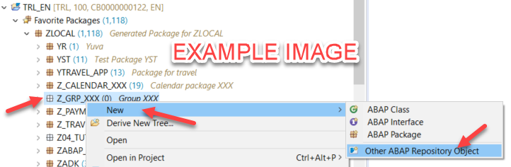

# Exercise 3 - Bring your own agent

The first two exercises reached the data-access agent through surfaces we built for you: Joule and the Utilities workspace. This exercise flips it around. Here the data access is a tool that any agent can call. Your agent brings the domain logic, and borrows grounded, authorized SAP data over a single call.

In the Agent surface you see this directly: you ask a question, the agent calls the data-access tool, gets grounded SQL and real rows back, and answers. That single tool call is the same primitive your own agents would use.

## Exercise 3.1 - Watch the tool call

1. Switch to the Agent surface.
2. Ask:
   > `TODO(Evan): a question that cleanly shows the tool-call trace, ideally one reused from Exercise 1 so attendees see the same answer arrive a different way.`
3. Watch the trace. The agent calls the data-access tool with your plain-language question, receives grounded SQL and the result rows, and composes the answer. The data access is a governed primitive; the agent did not need the schema.

 

> **Point to make:** this is the same capability from Exercises 1 and 2, now exposed as a tool. The access is governed and authorized once; any agent can call it without ever seeing the schema.

## Exercise 3.2 - Ask your own question

1. Replace the question with one of your own, within the domains and data you have seen:
   > `TODO(Evan): a safe "now you try" prompt, same backing data as Exercise 1.`
2. Confirm the agent calls the tool, gets grounded data back, and answers, with no schema input from you.

## Summary

You have seen the data-access agent three ways: inside Joule, driving a real customer workflow, and as a tool your own agent can call. One capability, grounded in live SAP data, reachable wherever your users and your agents already are.

That wraps up the hands-on exercises. Thanks for attending AS263. For questions and feedback, use the [Issues](../../issues) tab.
